  

---

<code>$ ls ~/featured</code>

 

**[conversation-intelligence-engine](https://github.com/anderescaray/conversation-intelligence-engine)** 
Customer calls in; intent, sentiment and a summary out. Personal data is redacted before any LLM sees it. About 2 s and $0.002 per conversation.

**[ambulancias-navarra](https://github.com/anderescaray/ambulancias-navarra)** 
Where to put the ambulance bases so they get everywhere faster. Constrained optimization and simulated annealing.

**[yolo-from-scratch](https://github.com/anderescaray/yolo-from-scratch)** 
Teaching a custom YOLOv4 to detect objects with very few labels, using active learning.

**[villavesa-lab](https://github.com/anderescaray/villavesa-lab)** 
Redesign Pamplona's bus network and see who gains or loses access in about a second.

<code>$ ls ~/daily-use</code>

 

**[kova](https://github.com/anderescaray/gymapp)** 
My gym log. Routines, rest timer, PRs and progress charts.

**[cents](https://github.com/anderescaray/cents)** 
Where my money went. Local-first: no backend, no ads, no tracking.

**[autoclicker-visual](https://github.com/anderescaray/autoclicker)** 
So I don't have to click the same five buttons 200 times.

<code>$ ls ~/other</code>

 

- **[hackathon-openai](https://github.com/anderescaray/hackathon-openai)**: find a flat by talking to a voice agent, built in three hours.
- **[gaia-agent](https://github.com/anderescaray/gaia-agent)**: multimodal agent, 70% on GAIA Level 1.
- **[autonomous-data-analyst](https://github.com/anderescaray/autonomous-data-analyst)**: drop in a CSV and an agent explains it to you.
- **[embat-x-ray](https://github.com/anderescaray/every-hackspain)**: financial-health score for companies (HackSpain 2026).
- **[ml-bike-demand-end-to-end](https://github.com/anderescaray/ml-bike-demand-end-to-end)**: from raw data to a Dockerized model.
- **[amazon-recsys](https://github.com/asierboveda/amazon-recsys)**: product recommendations, team project.

---

  

